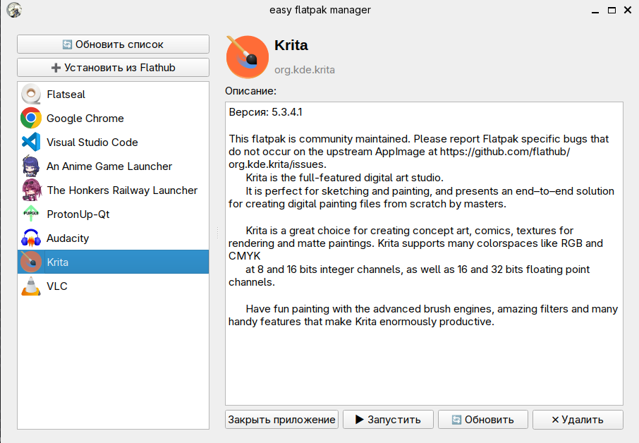

# Easy FLATPAK manager
Easy flatpak manager - это программа, что позволяет легко и просто использовать flatpak в системах linux.

Цель проекта это помочь тем, кто только открыл для себя linux и не привык к использованию терминала.
###### Скриншот программы

### Требования
- Linux
- установленный flatpak с [flathub](https://flathub.org/en/setup)
- Python 3.8+
### Как пользоваться
Первый запуск:
```bash
git clone https://github.com/Kermelycka/easy-flatpak-manager.git
```
```bash
cd easy-flatpak-manager
```
```bash
pip install -r requirements.txt
```
После этого ваша система будет готова и можно запускать саму программу:
```bash
python3 run.py
```
Если вам нужно будет ещё раз запустить программу нужно перейти в папку репозитория:
```bash
cd easy-flatpak-manager
```

Затем запускать саму программу через python:
```bash
python3 run.py
```
